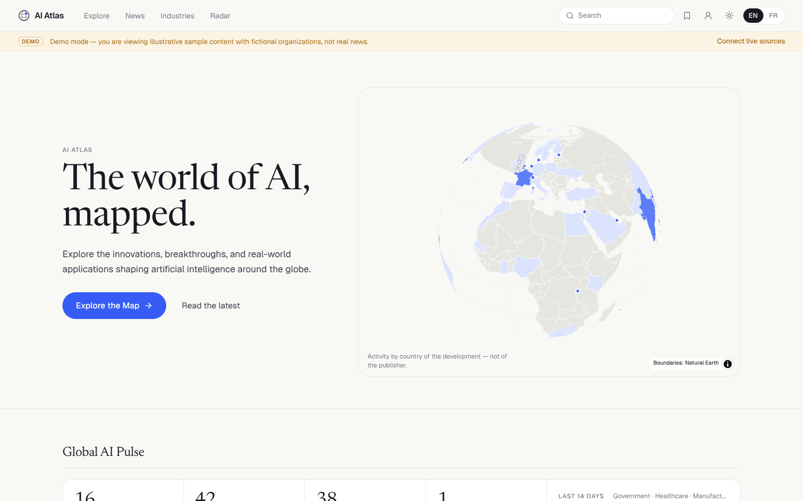
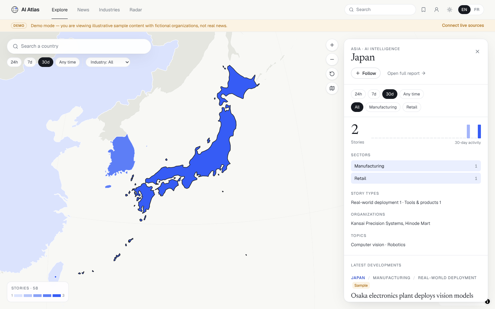
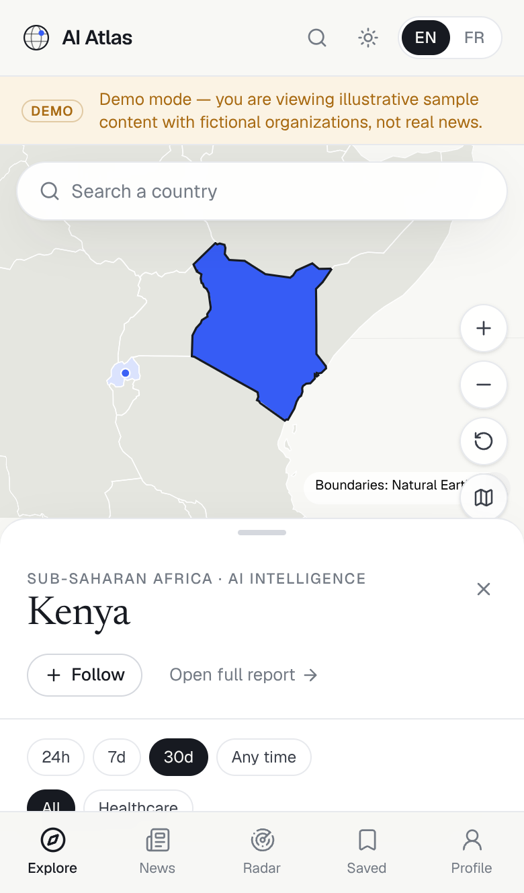
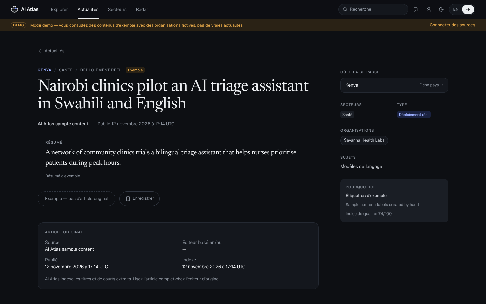

# AI Atlas — *The world of AI, mapped.*

An interactive, mobile-first platform for exploring artificial-intelligence developments country by country: an interactive world map, a classified international news feed, a personalized **AI Radar**, and an **Explorer Passport**. Available in English and French, light and dark.



| Explore (desktop) | Explore (mobile) | Article (FR, dark) |
| --- | --- | --- |
|  |  |  |

---

## Quick start

```bash
npm install
```

```bash
npm run dev
```

Open http://localhost:3000. **No credentials are required.** With nothing configured the app stores data in a local JSON file (`.data/atlas.json`) and shows **clearly labelled demo content** (fictional organizations, “Sample” badges, a persistent demo banner, no outbound links) until real news has been ingested.

To pull real news (needs outbound internet access to the feed hosts):

```bash
npm run ingest
```

As soon as at least one real article is stored, demo content disappears automatically (`DEMO_MODE=auto`).

### Scripts

| Script | What it does |
| --- | --- |
| `npm run dev` / `build` / `start` | Next.js dev server / production build / production server |
| `npm run ingest` | One ingestion run across all enabled providers |
| `npm run ingest:watch` | Ingest every `INGEST_INTERVAL_MINUTES` (default 20) |
| `npm run db:migrate` | Apply `supabase/migrations/*.sql` and upsert reference data (needs `DATABASE_URL`) |
| `npm test` | Unit + pipeline tests (Vitest). Set `TEST_DATABASE_URL` to also run the Postgres integration test |
| `npm run lint` / `npm run typecheck` | ESLint (incl. React Compiler rules) / TypeScript |
| `npm run geo:build` | Regenerate `src/data/countries.json` from `world-countries` |

---

## What works, and what needs credentials

| Capability | Status | Needs |
| --- | --- | --- |
| Interactive map (globe/flat, hover, selection, search, filters, panel, mobile bottom sheet) | ✅ Verified in Chromium (desktop + iPhone emulation) | — |
| News discovery: tabs, combined filters (country / region / global, industry, type, 24h / 7d / 30d / custom range, keyword, org, topic), sorting, pagination | ✅ Verified | — |
| Article detail with attribution, classification trace, related stories | ✅ Verified | — |
| Search across countries, organizations, topics, industries, articles | ✅ Verified (local + Postgres FTS) | — |
| My AI Radar (explainable recommender), Saved, Explorer Passport, achievements, weekly challenge | ✅ Verified — stored on device | — |
| English / French, light / dark | ✅ Verified | — |
| Local JSON storage | ✅ Verified | — |
| PostgreSQL / Supabase storage (schema, RLS, full-text search, all queries) | ✅ Verified against PostgreSQL 16 (integration test) | `DATABASE_URL` |
| RSS/Atom ingestion, dedup, classification, job monitoring | ✅ Verified end-to-end with local fixture feeds | Outbound access to feed hosts |
| GDELT DOC 2.0 ingestion | ⚠️ Parser verified with fixtures; live API not reachable from the build sandbox | Outbound access to `api.gdeltproject.org` |
| Event Registry / NewsAPI.org providers | ⚠️ Implemented from public API docs, **not exercised** | `EVENT_REGISTRY_API_KEY` / `NEWSAPI_KEY` |
| LLM summaries + classification review (Claude) | ⚠️ Implemented with structured outputs, **not exercised** | `ANTHROPIC_API_KEY` |
| Accounts (Supabase magic link) + sync of follows/saves | ⚠️ Implemented, **not exercised** | `NEXT_PUBLIC_SUPABASE_URL`, `NEXT_PUBLIC_SUPABASE_ANON_KEY`, migrated DB |
| Scheduled ingestion: cron route, CLI watcher, in-process scheduler | ✅ Implemented; auth on cron route verified | `CRON_SECRET` (cron), `INGEST_SCHEDULER=on` (in-process) |

> During development the sandbox's network policy blocked every news host, so live ingestion runs were recorded as `failed` jobs in the admin console (which is the intended behaviour). No real articles were fetched, and no sample was ever presented as real news.

---

## Architecture

```
src/
  app/                       Next.js App Router (all routes dynamic)
    page.tsx                 / — global overview (hero map, pulse, top stories, trends)
    explore/                 /explore — full-screen map + country panel
    country/[code]/          /country/JP — country intelligence
    news/  news/[slug]/      /news (tabs + filters), article detail
    industries/ [slug]/      industry intelligence
    radar/ saved/ profile/   personalization + passport
    search/ admin/           search, protected data administration
    api/                     articles, countries/[code], stats, search, radar, ingest, cron/ingest
  components/                map/, news/, country/, filters/, radar/, profile/, layout/, ui/, charts/
  lib/
    types.ts taxonomy.ts     domain model + industries / content types / topics / regions
    geo/countries.ts         249 countries (EN/FR names, regions, centroids, demonyms)
    classify/                geo.ts, rules.ts (industry/type/topics/entities/quality), dedupe.ts, llm.ts
    ingest/                  providers/{rss,gdelt,keyed}.ts, sources.ts, pipeline.ts, run.ts
    data/                    repository.ts (interface), pg-store.ts, local-store.ts, aggregate.ts
    recommend/score.ts       explainable weighted recommender
    passport.ts              achievements + weekly challenges
    i18n/                    dictionaries (en, fr), server/client helpers
    store/atlas-store.ts     device-local preferences, saves, passport
supabase/migrations/         0001_core.sql (news), 0002_users.sql (users, prefs, saves, follows, achievements)
scripts/                     ingest.mts, migrate.mts, postinstall.mjs, build-countries.mjs
tests/                       classify, ingest pipeline, recommend/passport, Postgres integration
```

**One data source for everything.** The map, country panels, feeds, search and radar all query the same repository with the same structured `ArticleQuery`. The local store applies it in memory and the Postgres store translates it to SQL, so a filter means the same thing everywhere.

### Event location vs. publisher location

Every article has **event countries** (where the development happens), **mentioned countries**, and a **source** with the publisher's own country. The map and every geographic filter use **event countries only**. The classifier never uses the publisher, its domain, or GDELT's `sourcecountry` to place a story. It reads the text: names in English and French, demonyms, capitals, AI-hub cities, with guards against false positives such as “Latin American”, “Georgia Tech” or “Michael Jordan”. Shared demonyms (e.g. “French”) resolve to the primary country. The article page shows the classification trace (“why it's here”).

### Ingestion pipeline

`fetch → validate → AI-relevance filter → classify → dedupe → store`, with one job record per provider:

- **Dates.** Items without a real publication date are rejected; we never invent one.
- **Duplicates.** Canonical URLs (tracking parameters, `www`/`amp` and trailing slashes removed) catch exact repeats. Near-duplicate headlines (token Jaccard ≥ 0.72 within 72h) are merged, and the existing story's `coverage` count goes up.
- **Classification.** Rules by default. With `ANTHROPIC_API_KEY`, Claude reviews geography, industries and type, and writes a ≤45-word summary from the publisher's own description only. Output is schema-validated and filtered against the taxonomy; anything invalid falls back to rules.
- **Attribution.** We store the headline, a short excerpt or summary, the dates, the source and the link. Readers are always sent to the original publication.

Scheduling options:

1. **Vercel / any cron:** `GET /api/cron/ingest` with `Authorization: Bearer $CRON_SECRET` (`vercel.json` runs it every 20 min; check your plan's cron limits).
2. **Long-running Node host:** `INGEST_SCHEDULER=on` runs ingestion inside `next start` via `instrumentation.ts`.
3. **Worker process:** `npm run ingest:watch`.

All three are single-flight. Ingestion jobs (fetched, inserted, duplicates, rejected, errors) appear at `/admin`.

### Ranking & personalization

- **Top stories:** 0.35·quality + 0.35·freshness (36h half-life) + 0.15·coverage + 0.15·source reliability.
- **My AI Radar:** points for followed countries (3), industries (2), topics (1.5), reading-history affinity (≤1.5), quality and freshness. The list is then re-ranked with diversity penalties for repeated countries and sectors. Each card says *why* it is there. `WEIGHTS.semantic` is reserved for embedding similarity later.

### Data model

Normalized tables: `countries`, `industries`, `topics`, `sources` (publisher country), `organizations`, `articles` (canonical URL unique, title fingerprint, quality, coverage, status, trace, `is_demo`, generated `tsvector`), and the join tables `article_countries` (role `event`/`mentioned`, confidence), `article_industries`, `article_topics` and `article_organizations`. Also `ingestion_jobs`. User data lives in `profiles`, `user_preferences`, `followed_entities`, `saved_articles`, `user_interactions`, `achievements` and `user_achievements`, all under owner-only RLS. Public tables have read-only RLS policies.

---

## Configuration

Copy `.env.example` to `.env.local`; every variable is documented there. Main ones:

- `DATABASE_URL` switches storage to PostgreSQL/Supabase; run `npm run db:migrate` first.
- `ADMIN_TOKEN` is **required in production**. Without it `/admin` is open in development only, and locked in production.
- `CRON_SECRET` protects the cron endpoint.
- `RSS_FEEDS` adds feeds as `url|name|publisherCountry|reliability;…`. `RSS_DEFAULT_FEEDS=off` drops the defaults.
- `ANTHROPIC_API_KEY` (+ optional `LLM_MODEL`, default `claude-opus-5-5`) enables LLM enrichment. Requests use low effort, structured outputs, and server-side refusal fallback.
- `NEXT_PUBLIC_SUPABASE_URL` and `NEXT_PUBLIC_SUPABASE_ANON_KEY` enable magic-link accounts.

Review each feed's terms before production use. Default feeds are public RSS/Atom endpoints from publishers and official sources.

## Known limitations

- Unknown article, country and industry URLs render the not-found page with `noindex`, but return HTTP 200 instead of 404 because the response has already started streaming.
- Map labels are omitted: the map renders fully offline from Natural Earth boundaries, with no tile or glyph server. Names appear on hover, in search, and in panels.
- Disputed or non-ISO polygons (e.g. Somaliland, N. Cyprus) are drawn but not selectable. Every ISO country is selectable from search, including micro-states missing from the 1:50m boundaries.
- Passport and saved stories are stored per device unless Supabase is configured.

## Credits

Boundaries: Natural Earth via `world-atlas` (public domain). Country metadata: `world-countries` (ODbL). Map rendering: MapLibre GL JS (BSD-3). Typography: Geist, Newsreader.
